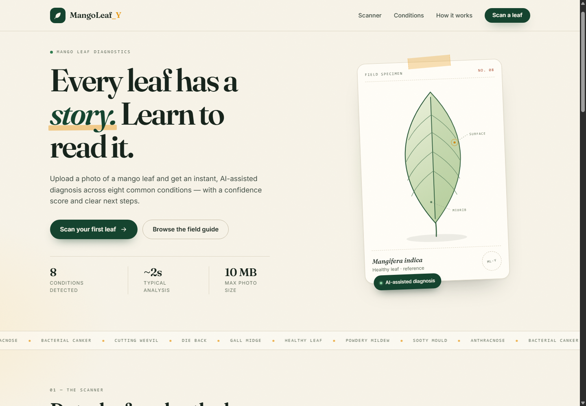
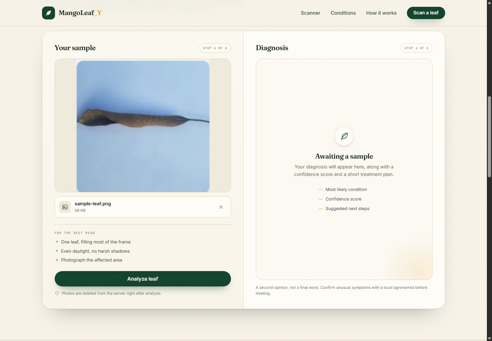

# MangoLeaf_Y — Mango Leaf Disease Detector

A Flask web application that classifies mango leaf images into 8 disease
conditions using a pre-trained deep learning model.

## How It Works

1. User uploads a leaf image through the browser UI (`templates/index.html`,
   `static/js/script.js`) — by browsing, drag-and-drop, or pasting from the
   clipboard. The UI validates the file type and size and shows a preview.
2. The image is sent to `POST /predict` in `app.py`.
3. The image is resized to 224×224, normalized to [0, 1], and passed through
   the model.
4. The API returns the predicted label and a confidence score (0–1). The UI
   renders the condition, a confidence meter, and practical treatment steps.

## Classes

| Index | Label              |
|-------|--------------------|
| 0     | Anthracnose        |
| 1     | Bacterial Canker  |
| 2     | Cutting Weevil    |
| 3     | Die Back          |
| 4     | Gall Midge        |
| 5     | Healthy           |
| 6     | Powdery Mildew    |
| 7     | Sooty Mould       |

## Tech Stack

- **Backend:** Python, Flask, Flask-CORS, Waitress (Windows) / Gunicorn (Linux)
- **ML:** TensorFlow / Keras (ResNet50 transfer learning)
- **Frontend:** HTML, CSS, vanilla JavaScript (responsive, accessible, no build step)
- **Deploy:** Render (see `Procfile`, `runtime.txt`)

## Requirements

- Python 3.12 – Python 3.14+ (64-bit recommended)
- See `requirements.txt` for dependencies

## Setup

```powershell
git clone https://github.com/Ifaz2611/MangoLeaf_Y
cd MangoLeaf_Y

python -m venv venv
.\venv\Scripts\Activate.ps1       # Windows PowerShell
# source venv/bin/activate        # Linux/macOS

# Install pre-built binary wheels (prevents legacy MinGW/GCC source build errors on Windows)
pip install --only-binary=:all: -r requirements.txt

# Start the application on Windows:
python app.py                     # Development server
python app.py --waitress          # Production WSGI server via Waitress
# Or run Waitress directly:
waitress-serve --host=0.0.0.0 --port=5000 app:app
```

Open http://127.0.0.1:5000 in a browser.

### Model File

`app.py` looks for the model at `models/disease_detector.keras`. If it is
missing, it downloads it from a Google Drive link using `gdown`.
The model is ~270 MB and is not committed to the repo.

Uploaded images are written to `uploads/` and deleted after each prediction.
Both `models/` and `uploads/` are created automatically and git-ignored.

## API

### `POST /predict`

Multipart form upload with field `file` (`png`, `jpg`, `jpeg`, `gif`, max 10 MB).

Response:

```json
{
  "predicted_class": "Powdery Mildew",
  "confidence": 0.9312
}
```

Error responses return `{"error": "..."}` with status 400, 413 or 500.

### `GET /health`

Returns `{"status": "ok"}` and can be used as a deployment health check.

## Project Structure

```
app.py                  # Flask app, model loading, /predict endpoint
templates/index.html    # Scanner, field guide, and result UI
static/css/style.css    # Design system and responsive styles
static/js/script.js     # Upload, validation, and prediction logic
models/                 # Downloaded model weights (git-ignored)
uploads/                # Temporary uploads, cleaned after each request (git-ignored)
saved_results/          # Training history & evaluation metrics (JSON)
screenshots/            # UI screenshots
requirements.txt        # Pinned Python dependencies
Procfile                # Gunicorn entrypoint for Render
runtime.txt             # Python version pin
LICENSE                 # MIT license
```

## Deployment

Configured for Render: `Procfile` runs `gunicorn app:app` (binding to `$PORT`)
and the app also binds to `PORT` from the environment when run directly
(default 5000).

## Screenshots

### Home / Upload


### Photo selected


### Result


## License

MIT
