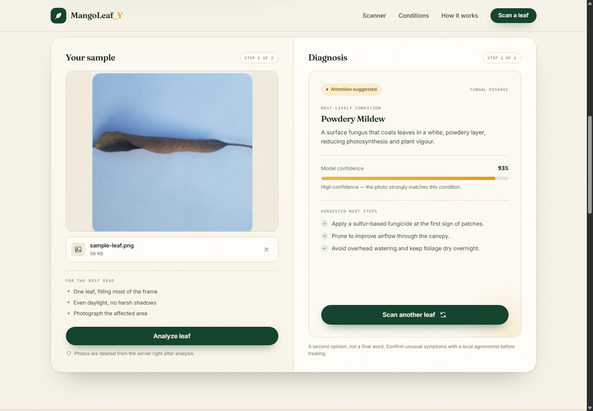

# MangoLeaf_Y — Mango Leaf Disease Detector

A Flask web application that classifies mango leaf images into 8 disease
conditions using a pre-trained deep learning model.

## How It Works

1. User uploads a leaf image through the browser UI (`templates/index.html`,
   `static/js/script.js`) — by browsing, drag-and-drop, or pasting from the
   clipboard. The UI validates the file type and size and shows a preview.
2. The image is sent to `POST /predict` in `app.py`.
3. The image is resized to 224×224, normalized to [0, 1], and passed through
   the model.
4. The API returns the predicted label and a confidence score (0–1). The UI
   renders the condition, a confidence meter, and practical treatment steps.

## Classes

| Index | Label              |
|-------|--------------------|
| 0     | Anthracnose        |
| 1     | Bacterial Canker  |
| 2     | Cutting Weevil    |
| 3     | Die Back          |
| 4     | Gall Midge        |
| 5     | Healthy           |
| 6     | Powdery Mildew    |
| 7     | Sooty Mould       |

## Tech Stack

- **Backend:** Python, Flask, Flask-CORS, Waitress (Windows) / Gunicorn (Linux)
- **ML:** TensorFlow / Keras (ResNet50 transfer learning)
- **Frontend:** HTML, CSS, vanilla JavaScript (responsive, accessible, no build step)
- **Deploy:** Render (see `Procfile`, `runtime.txt`)

## Requirements

- Python 3.12 – Python 3.14+ (64-bit recommended)
- See `requirements.txt` for dependencies

## Setup

```powershell
git clone https://github.com/Ifaz2611/MangoLeaf_Y
cd MangoLeaf_Y

python -m venv venv
.\venv\Scripts\Activate.ps1       # Windows PowerShell
# source venv/bin/activate        # Linux/macOS

# Install pre-built binary wheels (prevents legacy MinGW/GCC source build errors on Windows)
pip install --only-binary=:all: -r requirements.txt

# Start the application on Windows:
python app.py                     # Development server
python app.py --waitress          # Production WSGI server via Waitress
# Or run Waitress directly:
waitress-serve --host=0.0.0.0 --port=5000 app:app
```

Open http://127.0.0.1:5000 in a browser.

## Dataset

The model was trained on the **Mango Leaf Disease Dataset** (MangoLeafBD),
available on Kaggle:

**https://www.kaggle.com/datasets/aryashah2k/mango-leaf-disease-dataset**

It contains 4,000 mango leaf images across 8 classes (500 per class), matching
the `label_map` in `app.py`. The dataset is **not committed to this
repository** — it is listed in `.gitignore` because of its size (~140 MB) and
its CC BY 4.0 license.

> **Note:** you do not need the dataset to run the app. `app.py` downloads the
> trained weights automatically. The dataset is only needed if you want to
> retrain or fine-tune the model.

### Downloading the dataset

**Option A — Kaggle website (no CLI needed):**

1. Go to the dataset page above and click **Download** (requires a free
   Kaggle account).
2. Unzip the archive so you get a `Dataset/` folder containing the 8 class
   folders:

   ```
   Dataset/
   ├── Anthracnose/
   ├── Bacterial Canker/
   ├── Cutting Weevil/
   ├── Die Back/
   ├── Gall Midge/
   ├── Healthy/
   ├── Powdery Mildew/
   └── Sooty Mould/
   ```

**Option B — Kaggle CLI:**

```powershell
pip install kaggle
# Place your kaggle.json API token in ~/.kaggle/ (see Kaggle → Settings → API)
kaggle datasets download -d warcoder/mango-leaf-disease-dataset -p Dataset --unzip
```

Then move the extracted class folders into `Dataset/` as shown above.

### Verifying the dataset

Each class folder should contain 500 `.jpg` images:

```powershell
Get-ChildItem Dataset -Directory | ForEach-Object { "{0}: {1}" -f $_.Name, (Get-ChildItem $_.FullName -File).Count }
```

## Model File

`app.py` looks for the model at `models/Mango_Leaf_disease_detector.keras`
(the same name the file has on Google Drive). If it is missing, it downloads it
automatically from the Google Drive link using `gdown` (no manual step
required). The model is ~100 MB and is not committed to the repo — place a
compatible `.keras` file there if you want to use your own weights.

Upgrading from an older checkout? The previously downloaded
`models/disease_detector.keras` is renamed automatically, so the ~100 MB file
is not downloaded twice.

Uploaded images are written to `uploads/` and deleted after each prediction.
Both `models/` and `uploads/` are created automatically and git-ignored.

## API

### `POST /predict`

Multipart form upload with field `file` (`png`, `jpg`, `jpeg`, `gif`, max 10 MB).

Response:

```json
{
  "predicted_class": "Powdery Mildew",
  "confidence": 0.9312
}
```

Error responses return `{"error": "..."}` with status 400, 413 or 500.

### `GET /health`

Returns `{"status": "ok"}` and can be used as a deployment health check.

## Project Structure

```
app.py                  # Flask app, model loading, /predict endpoint
templates/index.html    # Scanner, field guide, and result UI
static/css/style.css    # Design system and responsive styles
static/js/script.js     # Upload, validation, and prediction logic
models/                 # Downloaded model weights (git-ignored)
uploads/                # Temporary uploads, cleaned after each request (git-ignored)
Dataset/                # Training images — download from Kaggle (git-ignored)
saved_results/          # Training history & evaluation metrics (JSON)
screenshots/            # UI screenshots
requirements.txt        # Pinned Python dependencies
Procfile                # Gunicorn entrypoint for Render
runtime.txt             # Python version pin
LICENSE                 # MIT license
```

## Deployment

Configured for Render: `Procfile` runs `gunicorn app:app` (binding to `$PORT`)
and the app also binds to `PORT` from the environment when run directly
(default 5000).

## Screenshots

### Home / Upload


### Photo selected


### Result


## License

MIT
